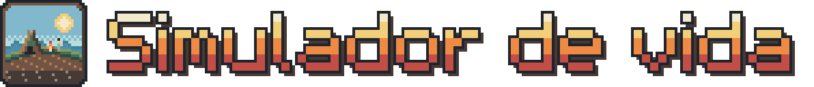
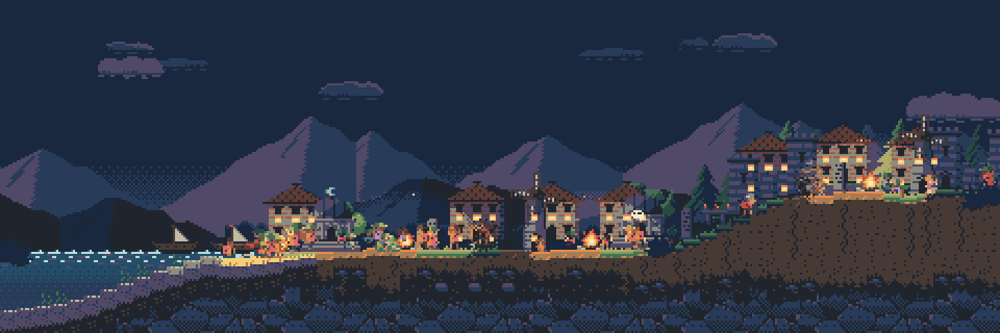
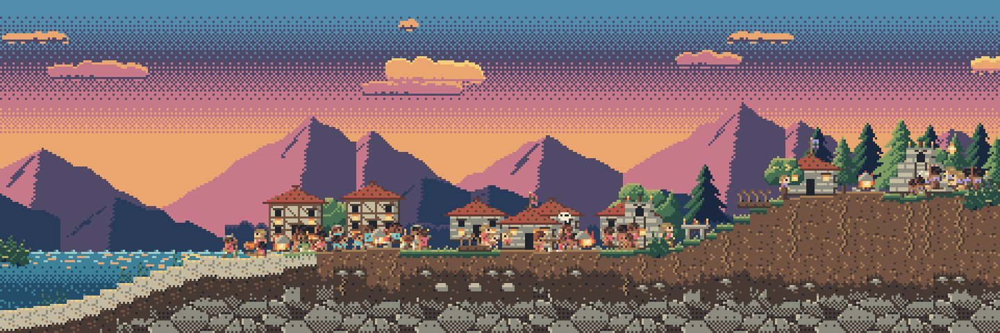
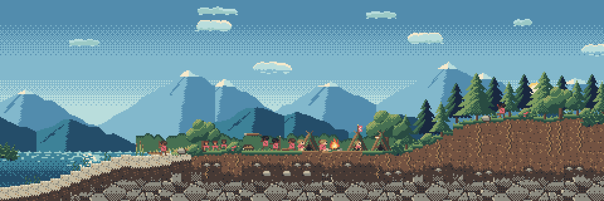
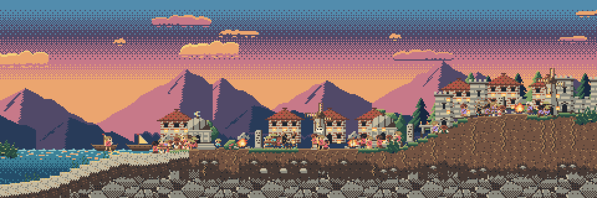
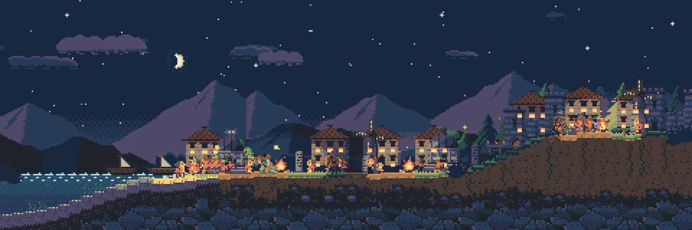
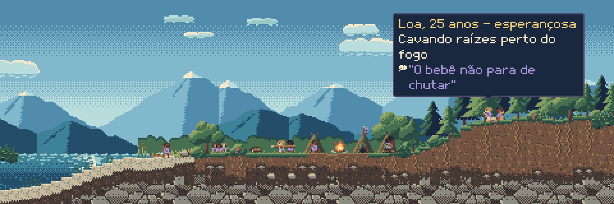
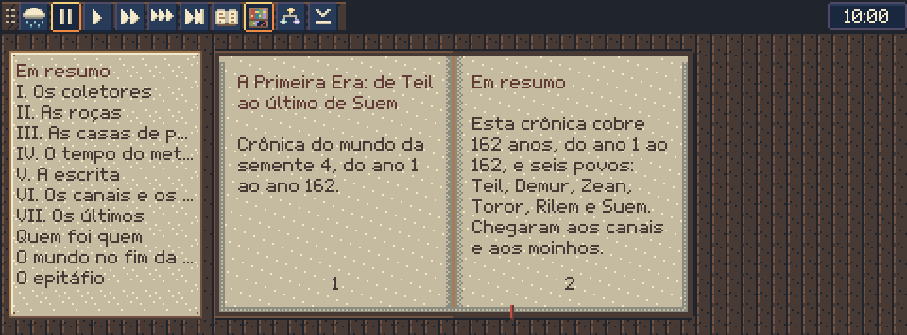
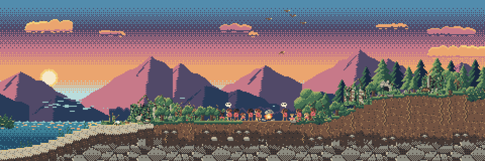
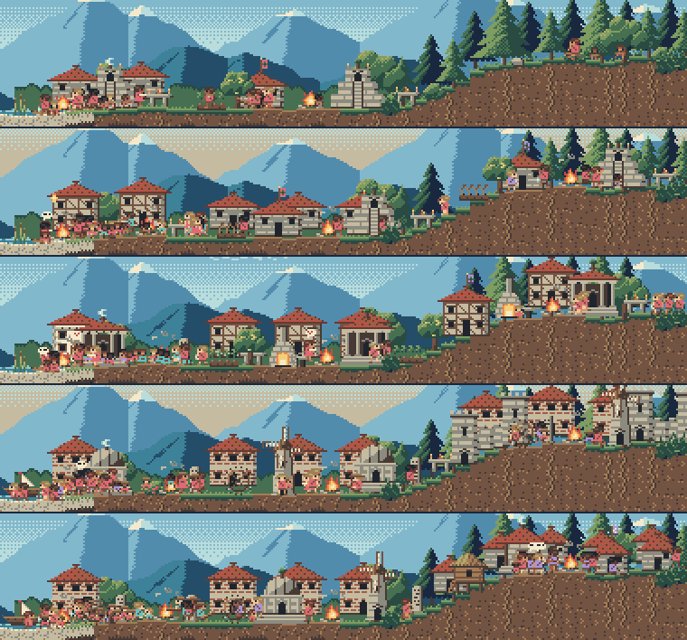

  

  <b>Um pequeno mundo que vive sozinho num canto da sua tela. 
  Você é o deus dele, e ninguém pode te ver.</b>

  <a href="https://github.com/agentevsagente-debug/SimuladorVida/releases"><b>Baixar para Windows</b></a> ·
  <a href="docs/como-jogar.md">Como jogar</a> ·
  <a href="docs/tempo-e-evolucao.md">Tempo e evolução</a> ·
  <a href="docs/mecanicas.md">Mecânicas</a> ·
  <a href="docs/como-foi-feito.md">Como foi feito</a>

  
   Um dia inteiro de jogo numa vila que já chegou aos moinhos, do amanhecer à madrugada, capturado em 50x e acelerado no GIF. No jogo, esse dia dura 54 segundos em 50x e 45 minutos em 1x.

---

## O que é

**Simulador de vida** é um jogo gratuito para Windows que fica aberto num canto da tela, numa janela transparente, por cima das outras, enquanto você trabalha. Lá dentro, um povo de pixel art nasce, caça, planta, briga, reza, envelhece e passa o que sabe aos filhos, ano após ano, mesmo quando você não está olhando. Você é o deus desse povo: não manda em ninguém, só faz gestos (chuva, raio, fogo, fartura, um sonho...) e vê como cada povo os interpreta. Tudo o que acontece fica escrito numa crônica, e quando um mundo acaba, a crônica vira um livro na sua estante.

## O que ele tem de diferente

- **Um deus invisível.** O povo nunca vê você, só os efeitos. Uma chuva depois de uma prece vira milagre, mesmo que tenha sido o acaso; um terremoto natural vira castigo que você não deu. Cada povo dá ao deus o próprio nome, como "o Que Rega" ou "o Que Fere", e é pelo nome que você descobre como ele te vê.
- **Um povo que vive sozinho.** Ninguém obedece ao jogador. As pessoas têm traços, famílias, fome, rancores e crenças. Os povos se separam por migração, briga ou cisma religioso, mudam de cultura e fazem guerra sem pedir licença.
- **Uma crônica escrita pelo próprio mundo.** Cada ano vira um parágrafo, montado a partir do que de fato aconteceu: os atos do deus e também a vida do povo, com quem nasceu, casou e morreu. Não há modelo de linguagem nem internet: os textos saem de uma gramática de frases em português, com concordância.
- **Seis estágios, sem árvore de pesquisa.** Da coleta à agricultura, à pedra, ao metal, à escrita e aos canais e moinhos. O saber vive nas pessoas e pode se perder quando morre o último que sabia.
- **O fim do mundo é real.** A população pode acabar, inclusive enquanto o jogo está fechado. O mundo vazio continua vivo, as ruínas ficam, e o povo que você fizer nascer depois inventa histórias sobre elas.
- **Um companheiro de tela.** O ritmo normal é lento (um dia de jogo dura cerca de 45 minutos). O mouse passa pelos espaços vazios da janela, então dá para trabalhar com ela aberta. Fechado, o mundo continua andando até o teto de 1 ano de jogo.
- **Leve.** Em 1x, o jogo usa por volta de 5% de **um** núcleo do processador; escondido, 0,2%. No Gerenciador de Tarefas, a memória do jogo fica perto de 110 MB num mundo novo e de 180 MB num mundo de 150 a 200 anos. [Como foi medido](docs/como-foi-feito.md#leveza).

## Galeria

Todas as imagens abaixo são capturas do jogo, ampliadas sem suavização, como a janela mostra nas escalas 2x a 4x.

| | |
|---|---|
|  |  |
| **O entardecer.** O povo volta e faz a roda em volta do fogo. | **A caçada.** Os caçadores se aproximam agachados, e a lança voa. |
|  |  |
| **Os canais e os moinhos.** Uma vila 200 anos depois, no último estágio. | **A mesma vila à noite.** |
|  |  |
| **Quem é essa pessoa?** Passe o cursor para ver o humor, o que ela faz e o que pensa. | **A estante.** Cada mundo que acaba vira um livro, com capítulos e epitáfio. |
|  |  |
| **O recomeço.** Um povo novo acende a primeira fogueira entre as ruínas do anterior. | **Da pedra aos moinhos.** O mesmo mundo nos anos 55, 90, 120, 200 e 400: estágios 3, 4, 5 e 6. |

## Baixar e jogar

1. Abra a página de **[Releases](https://github.com/agentevsagente-debug/SimuladorVida/releases)** e baixe a versão mais recente.
2. Rode o `Simulador de vida.exe`. Não há instalador: é um arquivo só, de cerca de 108 MB.
3. **Aviso do Windows (SmartScreen).** O jogo não tem assinatura digital, então o Windows pode mostrar "O Windows protegeu o computador". Clique em **Mais informações** e depois em **Executar assim mesmo**.
4. O mundo começa vazio. Clique sobre ele para fazer nascer o primeiro povo.

**Requisitos:** Windows 10 ou 11, 64 bits. Não precisa de internet. O jogo é em português do Brasil e tem som discreto, que se desliga com um clique (botão de som na alça, tecla **M** ou o menu do ícone perto do relógio).

## Teclas e o gesto do poder

**O gesto:** na barra de cima (a alça), escolha um poder, clique sobre o mundo e **segure**. Quanto mais tempo segurar, mais forte: um gesto curto é um **sinal** discreto; segurando mais de 1 segundo, vira um **milagre**. Solte, e a alça conta o que aconteceu. O fogo curto é o **fogo brando**: acende as fogueiras e aquece, sem queimar.

| Tecla | O que faz |
|---|---|
| **C** | a crônica do mundo (↑ e ↓ trocam de capítulo) |
| **E** | a estante com os livros dos mundos que acabaram |
| **P** | a caixa de preces (também pelo botão no fim da alça, depois da lupa) |
| **L** | segue a família que você acompanha |
| **D** | modo discreto: o pior fica só na crônica, sem ser mostrado |
| **H** | esconde a janela (para trazer de volta: o ícone perto do relógio do Windows, ou **Ctrl+Alt+H**) |
| **0, 1, 2, 3** | pausa, 1x (1 dia ≈ 45 min), 10x e 50x |
| **Espaço** | pausa e continua |
| **S** | salta até o próximo acontecimento |
| **M** | liga e desliga o som (também pelo botão na alça e pelo menu do ícone perto do relógio) |
| **Ctrl+2, 3, 4** | o tamanho da janela (também pelo botão da lupa na alça: clique aumenta, botão direito diminui) |
| **Ctrl+Q** | sair (o mundo é salvo) |

Passe o cursor sobre as pessoas para ver quem são, e sobre um sinal de luz para ler uma prece. A **caixa de preces** (P) junta todas as preces, com o estado de cada uma e um termômetro de fé por povo. O guia completo, com imagens, está em **[Como jogar](docs/como-jogar.md)**.

## Para saber mais

- **[Como jogar](docs/como-jogar.md):** o primeiro povo, o gesto, as preces, a crônica, a estante, esconder a janela, onde fica o mundo salvo e como desinstalar.
- **[Tempo e evolução](docs/tempo-e-evolucao.md):** quanto dura um dia, uma estação e um ano em cada velocidade, e quanto tempo um povo leva para chegar a cada estágio.
- **[Mecânicas](docs/mecanicas.md):** os 11 poderes e as intensidades, preces, religião, culturas, linhagem, fim do mundo e modo discreto.
- **[Como foi feito](docs/como-foi-feito.md):** a linha do tempo, a arquitetura, a arte, as auditorias, o QA e as medições de leveza.
- **[Notas da versão 0.3.1](docs/NOTAS-DA-VERSAO-0.3.1.md):** o que tem, os problemas conhecidos e como relatar um erro.

## Feito por IA

O jogo inteiro (código, arte, textos e testes) foi feito por inteligência artificial. Sessões do **Claude Code** trabalharam em paralelo, cada uma na sua área (simulação, apresentação, arte e QA), coordenadas por outra sessão do Claude, que dividia o trabalho, revisava as entregas e juntava as partes. As primeiras peças de arte e a paleta de cores foram feitas pelo **Codex**, da OpenAI; depois de uma comparação, a arte passou para o Claude. Uma pessoa definiu a ideia, tomou as decisões de produto e escolheu entre as opções apresentadas.

Segundo o histórico do git, o primeiro commit é de 31/10/2026, às 23h54, e a versão 0.1.1 ficou pronta em 01/11/2026, às 21h02. A maior parte dos testes foi feita por scripts e por sessões de IA jogando o jogo. Esta é a primeira versão aberta ao público, então relatos de quem joga de verdade ajudam muito. A história completa está em **[Como foi feito](docs/como-foi-feito.md)**.

## Relatar um erro

Abra uma [issue](https://github.com/agentevsagente-debug/SimuladorVida/issues) com:
- a versão (passe o cursor sobre o relógio, no canto da alça);
- o que você fez logo antes;
- o arquivo de registro `%APPDATA%\Simulador de vida\logs\godot.log`.

## Licença

Código aberto, sob a **[licença MIT](LICENSE)**. Vale para o repositório inteiro, código e arte: você pode usar, modificar e redistribuir livremente, inclusive em projetos comerciais, desde que mantenha o aviso de copyright e o texto da licença.

Copyright (c) 2026 Sergio Andrade.
