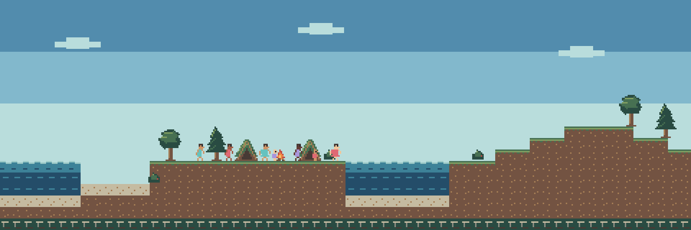
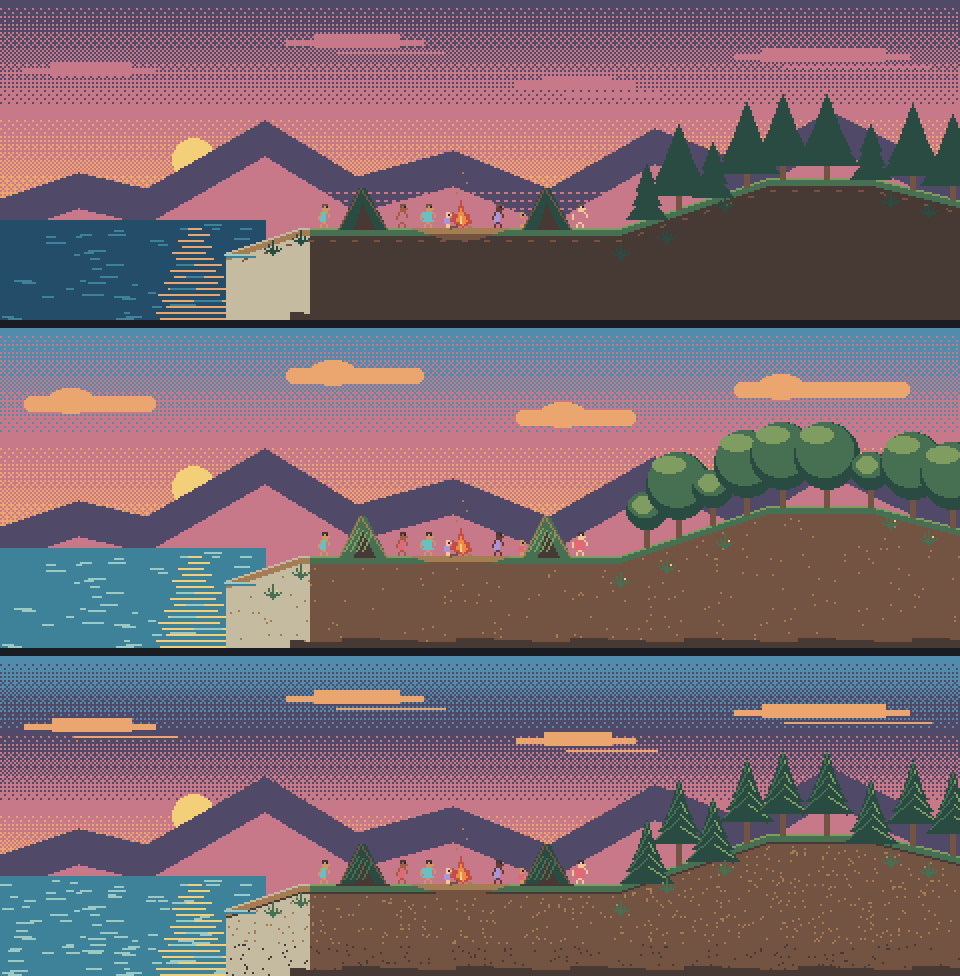
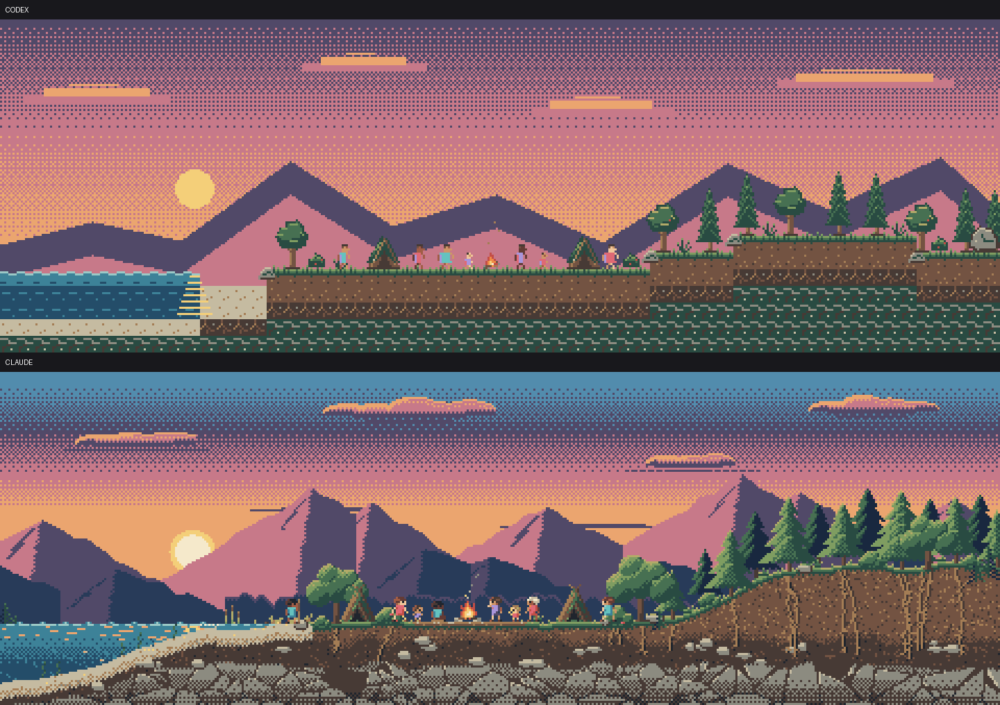
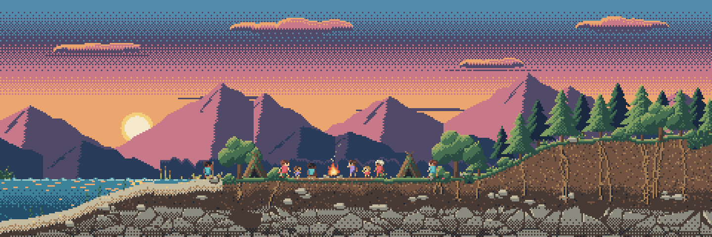
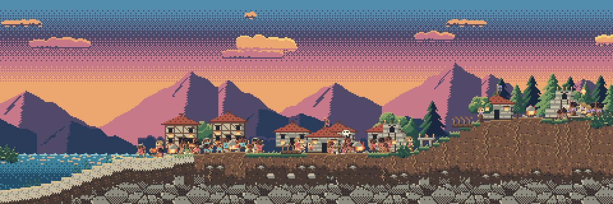
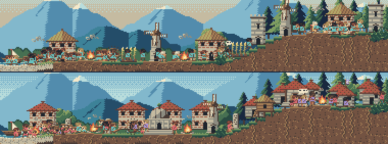

# Como foi feito

*Simulador de vida 0.1.1. [Voltar ao início](../README.md)*

O jogo foi construído inteiramente por IA: código, arte, textos, testes e esta página. Uma pessoa teve a ideia, definiu o que o jogo devia ser e tomou as decisões de produto. O resto foi feito por sessões do **Claude Code** trabalhando em paralelo, coordenadas por outra sessão do Claude, com uma participação do **Codex**, da OpenAI, no começo da arte.

Os documentos de partida continuam na raiz do repositório: o [documento funcional](../prompt-funcional-simulador-de-vida.md), que diz o que o jogo é, e o [documento técnico](../tecnico-simulador-de-vida.md), que diz como construí-lo.

## Linha do tempo

Datas e horas dos commits, segundo o `git log`. Até a versão 0.1.1, são 296 commits, do primeiro, em 31/10/2026 às 23h54, ao último, em 01/11/2026 às 21h02.

| Quando | Fase | O que aconteceu |
|---|---|---|
| 31/10, 23h54 | **Início** | Os documentos funcional e técnico, o protocolo do Codex e os briefings da fase 0 |
| 01/11, 00h02 a 00h53 | **Fase 0: testes de risco** | Três frentes em paralelo, cada uma respondendo a uma pergunta. A simulação em texto produz histórias que valem a pena ler? (sim: 100 anos simulados em cerca de 1 s). A janela transparente funciona no Windows e é leve? (sim: 1,5% de um núcleo com 30 bonecos andando). A IA faz pixel art consistente? (a comparação da arte decidiu quem faria). Fase 0 aprovada às 00h53 |
| 00h53 a 05h34 | **Fase 1: o menor jogo que entrega a essência** | O núcleo e a janela unidos no projeto Godot: o primeiro povo, as preces como sinais, os 6 primeiros poderes, a linhagem, a crônica, salvar e a ausência. Os critérios de saída foram registrados com evidência às 05h34 |
| 01h50 a 05h54 | **Fase 2, adiantada** | A simulação e a arte terminaram a fase 1 antes da integração e adiantaram a fase 2: os 5 poderes restantes, os estágios 3 a 6, o fim do mundo e as eras, a estante e as 6 dimensões culturais |
| 04h20 a 20h51 | **Polimento por auditorias** | 12 auditorias de jogador, com notas por área, cada uma gerando uma lista de correções para as outras sessões (abaixo) |
| 09h03 | Exportação | O preparo do executável portátil para Windows |
| 19h02 a 20h53 | **QA por cenários** | A matriz de cenários, a bateria automática e a primeira rodada, com 14 defeitos; as correções foram entrando na mesma noite |
| 19h23 | **Versão 0.1.0** | O primeiro executável completo, verificado no próprio `.exe` |
| 20h59 a 21h02 | **Versão 0.1.1** | O mundo começa vazio, com bichos e o convite para criar o povo; a crônica de um capítulo só |

## Arquitetura

O jogo é feito no **Godot 4.7.2**, em GDScript, sem nenhuma dependência externa: sem internet, sem serviços e sem modelo de linguagem.

**O núcleo separado da apresentação.**
- O **núcleo** (`jogo/nucleo/`) é a simulação, em GDScript puro, sem cenas, nós ou gráficos. Ele recebe o tempo e os gestos do deus e devolve o estado do mundo e uma lista de eventos. Roda sem janela (`--headless`), e é assim que simula a ausência e que os testes rodam.
- A **apresentação** (o resto de `jogo/`) desenha o mundo, os efeitos e a interface. Ela só lê o estado e os eventos e só age por chamadas públicas do núcleo. Nunca decide nada sobre o mundo.
- O contrato entre os dois é a API documentada em `jogo/nucleo/API.md`.

**Determinismo.** Todo sorteio da simulação sai de um gerador com a semente do mundo. A mesma semente, com os mesmos gestos nas mesmas horas, dá o mesmo mundo e a mesma crônica. Isso permite reproduzir um defeito, comparar versões e medir o equilíbrio em dezenas de mundos.

**Os eventos como fonte única.** Tudo o que importa vira um evento estruturado: tipo, quem, onde, quando, a causa (natural, social ou divina) e a importância. Da mesma lista de eventos saem:
- a **crônica**, escrita ano a ano;
- as **preces** e os **chamados** na tela;
- a **memória do mundo**: os nomes dos lugares, os rancores, os costumes e a sua origem;
- o **pensamento** de cada pessoa na dica do cursor.

Nenhuma dessas partes inventa fatos: todas leem os mesmos eventos.

**Texto sem modelo de linguagem.** A crônica, as preces e os nomes do deus saem de uma gramática de frases em português, com concordância de gênero e número, preenchida com os dados dos eventos. Os nomes de pessoas e lugares saem de conjuntos de sílabas por cultura. A crônica evita repetir uma frase usada nos últimos 25 anos.

**Persistência.** O mundo é salvo em texto legível, a cada dia de jogo e ao fechar, com soma de verificação e cópias de segurança. Um arquivo que não se lê é guardado à parte, nunca sobrescrito. Os livros da estante ficam fora do mundo salvo, também com cópias. Eventos de mais de 300 anos saem da memória viva para um arquivo próprio e voltam quando preciso.

**Atmosfera por código.** O céu em degradê com pontilhado, as nuvens, o sol e a lua com fases, as estrelas, o reflexo na água, a luz do fogo, a neblina, a chuva, o clarão do raio e as trocas de cor por horário são desenhados pelo motor, com shaders simples, e não são arte pronta.

## A arte

Toda a arte é pixel art **gerada por código Python**: cada imagem tem o script que a desenha, pixel a pixel, numa paleta fixa de 32 cores, sem pixels semitransparentes.

**1. As primeiras tentativas (Codex).** O Codex fez a paleta, as primeiras peças (terreno, habitantes, abrigos) e uma cena de teste. Funcionava, mas ainda não tinha a cara de um jogo.

**2. A escolha da direção.** O Codex então desenhou a mesma cena em três direções visuais. O usuário escolheu a **C, "Clássica 16 bits"**: pinheiros com luz nas bordas, textura mineral e mais contraste.

*As direções A, B e C, de cima para baixo.*

**3. A cena-alvo, em competição.** Na direção C, o Codex e o Claude fizeram a mesma cena-alvo, e o Claude sem olhar a do Codex: o mundo inteiro, ao entardecer, de dia e de noite. O usuário comparou as duas e escolheu a do Claude. O Codex foi desligado (às 00h24 de 01/11), e a arte passou para uma sessão do Claude. A paleta do Codex continua em uso.

**4. A cena-alvo virou a referência.** A cena do Claude (`arte_claude/alvo/`) passou a ser a referência visual oficial: o chão a 75% da altura, três planos de profundidade, o corte do solo com raízes e rochas, o degradê do céu com pontilhado Bayer 4 × 4. A arte foi então quebrada em peças modulares, que o jogo remonta.

**5. No jogo.** As peças cresceram para os 6 estágios, as culturas, as estações, as ações do cotidiano, os bichos e os efeitos dos poderes. Uma captura do jogo de verdade:

E o efeito das auditorias: a vila do estágio 6 na auditoria 7 (em cima) e, depois das correções, na auditoria 9 (embaixo).

## As auditorias de jogador

A sessão de arte também fazia o papel de jogador: rodava o jogo, capturava a tela em horários e situações escolhidos, dava notas de 1 a 5 a cada área e listava o que corrigir, com quem. As outras sessões corrigiam, e a auditoria seguinte repetia o mesmo roteiro para comparar.

| Área | Auditorias | Notas |
|---|---|---|
| **O cotidiano** (manhã, tarde, fim de tarde, noite) | 3 → 4 → 5 → 6 | soma de 12 → 16 → 18 → 18; a tarde foi de 2 a 4, e a noite, de 3 a 5 |
| **Os estágios 3 a 6** | 7 → 9 | 3, 3, 2 e 3 → 4, 4, 4 e 5 |
| **A primeira hora** de quem nunca jogou | 8 → 10 → 12 | 3 → 4 → 4 |
| **O jogo como produto** (8 áreas) | 11 | 4 em todas: primeira hora, cotidiano, poderes, estágios, crônica e livros, fim do mundo, interface e leveza |

**O que pesa nessas notas:**
- Quem dava as notas era uma sessão de IA, não uma pessoa.
- Nas auditorias da primeira hora e do produto (8, 10, 11 e 12), a sessão do Windows estava bloqueada. O jogo foi jogado com entrada injetada por dentro do Godot, pelo mesmo caminho do mouse e do teclado de verdade, e capturado pelo próprio jogo.
- A auditoria 11 registra que ninguém tinha usado o jogo com a mão até ali. Depois dela, a janela de verdade (por cima de outros programas, arrastar, esconder e trazer de volta, fechar pelo X) foi verificada por scripts no executável.
- A auditoria 12 deu 4 e projetou 5 com duas correções (o convite no chão e os bichos no mundo vazio). As duas entraram na versão 0.1.1, mas a auditoria não foi refeita depois delas.

Os relatórios estão em `arte_claude/auditoria/`.

## O QA por cenários

Uma sessão própria de QA escreveu a matriz de cenários do jogo a partir do documento funcional (`qa/cenarios.md`), no formato "Dado / Quando / Então", por área: começo do mundo, cotidiano, os 11 poderes, preces, religião, culturas, estágios, linhagem, ausência, persistência e saves estragados, fim do mundo, estante, modo discreto, janela e leveza.

- **123 cenários:** 102 automatizados no núcleo (`jogo/qa/rodar_qa.gd`), 12 automatizados na janela e 9 que precisam de mouse e teclado de verdade.
- **A primeira rodada** encontrou 14 defeitos. Entre eles: os testes do núcleo escreviam na estante real do jogador; o raio acertava onde a pessoa estaria no fim da hora, e não onde ela estava na tela; um mundo salvo ilegível era sobrescrito em silêncio; a CPU num mundo de 200 anos passava da meta; e o mundo começava com o povo, quando o documento dizia que devia começar vazio.
- Quase todos foram corrigidos na mesma noite, antes da 0.1.1, segundo os commits. O que ficou em aberto está nas [notas da versão](NOTAS-DA-VERSAO-0.1.1.md#problemas-conhecidos). O relatório e as rodadas estão em `qa/`.

## Leveza

A meta era um jogo que pudesse ficar aberto o dia todo sem pesar.

**O método** (`jogo/ferramentas/medir.ps1`): o jogo roda 10 minutos num cenário fixo. Depois de 10 s de aquecimento, o script lê o tempo de CPU e a memória do processo a cada 5 s. A CPU é dada de dois jeitos:
- **% de um núcleo:** o tempo de CPU dividido pelo tempo real. É a medida que não depende do computador ter muitos núcleos: 5% de um núcleo é 5% do que um único núcleo faz.
- **% da máquina:** o mesmo número dividido pelo número de núcleos lógicos. O computador das medições tem 28, então 5,3% de um núcleo é 0,19% da máquina.

A memória está na medida que o Gerenciador de Tarefas mostra na coluna "Memória" (o conjunto de trabalho privado).

| Cenário | CPU, % de um núcleo | CPU, % da máquina (28 núcleos) | Memória no Gerenciador (média) |
|---|---|---|---|
| **Executável**, mundo novo, 1x | 5,3% | 0,19% | 107 MB |
| Mundo novo, 10x | 5,0% | 0,18% | 128 MB |
| Mundo novo, 50x | 5,2% | 0,18% | 130 MB |
| Escondido | 0,2% | 0,008% | 102 MB |
| Mundo de 200 anos, 1x (3 min) | 6,1% | 0,22% | 179 MB |
| **Executável**, mundo de 150 anos (estágio 6, 4 povos), 50x | 7,8% | 0,28% | 168 MB (máximo de 182) |

- As linhas sem "Executável" foram medidas pelo editor do Godot, que usa um pouco mais de memória (123 MB contra 107 MB no mundo novo em 1x).
- No mundo de 200 anos em 1x, a medição do QA deu de 7,1% a 7,3% de um núcleo. Antes de uma correção, era de 14% a 15%.
- A memória cresce com o mundo: cerca de 110 MB no começo e de 170 a 180 MB depois de 150 a 200 anos. O conjunto de trabalho completo é maior (de 200 a 300 MB), porque inclui páginas compartilhadas com o driver de vídeo.
- Para economizar, o jogo desenha no máximo 30 quadros por segundo (20 em 1x e na pausa) e, escondido, para de desenhar.
- O executável tem cerca de 106 MB.
- As medições foram feitas sem o atalho global Ctrl+Alt+H, que o jogo liga sozinho ao abrir. O Godot não tem atalho global, então ele roda num processo à parte, do PowerShell, com CPU praticamente zero e cerca de 77 MB de memória a mais (medido no protótipo da janela, na fase 0).

## Como as sessões de IA foram organizadas

| Sessão | Área (só ela edita) | O que fez |
|---|---|---|
| **Orquestrador** (Claude) | os documentos da raiz e `sessoes/` | dividiu o trabalho, escreveu os briefings, revisou as entregas, juntou as branches e levou as decisões ao usuário |
| **A, simulação** | `jogo/nucleo/`, `jogo/ferramentas_sim/` | o núcleo, a crônica, a persistência, a ausência, o equilíbrio e as ferramentas de medição |
| **B, apresentação** | o resto de `jogo/` | a janela transparente, o desenho do mundo, os efeitos, a interface, o executável e as medições de leveza |
| **C, arte** | `arte_claude/` | toda a arte depois da cena-alvo, as auditorias de jogador e as imagens de divulgação |
| **D, QA** | `qa/` e `jogo/qa/` | a matriz de cenários, a bateria automática e o relatório de defeitos |
| **E, página pública** | `README.md` e `docs/` | esta página |
| **Codex** (OpenAI) | `arte/` e `codex/` | a paleta, as primeiras peças, a prancha das três direções e a cena-alvo concorrente |

**As regras que fizeram isso funcionar:**
- **Cada sessão só edita a própria pasta**, cada uma no seu `git worktree` e na sua branch. Duas sessões nunca mexem no mesmo arquivo, e o orquestrador junta tudo na `main`.
- **Contratos escritos.** A simulação e a apresentação conversam só pela API documentada. Quando uma sessão precisa de algo da outra, pede ao orquestrador.
- **Entregas com evidência.** Cada entrega vem com um relatório, capturas e medições (`jogo/RELATORIO.md`, as auditorias, o relatório de QA).
- **Decisões do usuário, registradas.** O usuário escolheu a direção visual C e a cena-alvo do Claude, aceitou a memória acima de 200 MB no conjunto de trabalho e pediu a dica com o pensamento da pessoa. O que ele não decidiu foi completado seguindo a linha das decisões dele, e ficou registrado como revisável no documento funcional.
- **Os commits** saem no nome do usuário, com a coautoria do Claude registrada em cada um.
