# Como jogar

*Simulador de vida 0.1.1. [Voltar ao início](../README.md)*

Você é o deus de um pequeno mundo. Não manda em ninguém: só faz gestos e vê o que o povo faz com eles. Não há objetivo, pontuação nem derrota. O jogo é acompanhar o mundo crescer e as histórias acontecerem.

A janela é transparente e fica por cima das outras. O mouse passa pelos espaços vazios, então dá para trabalhar com ela aberta. Para mudá-la de lugar, arraste pela alça, a barra de botões de cima.

## 1. O primeiro povo

O mundo começa vazio, de manhã: o lago, a praia, a clareira, a floresta e o morro, com alguns bichos. A alça diz o que fazer, e a dica junto do cursor também.

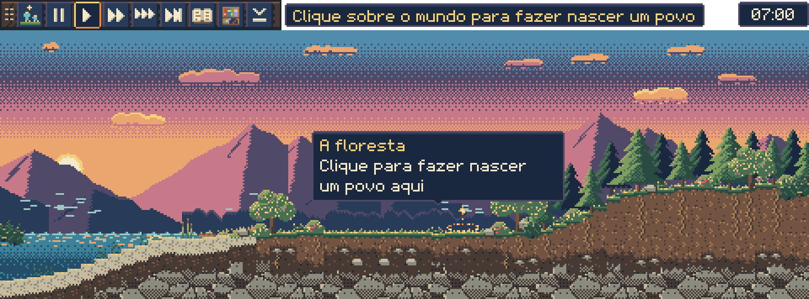

Clique sobre o mundo, onde brilha o anel de luz ou onde quiser. Uma família de 12 coletores chega, se junta, acende a primeira fogueira e ergue as cabanas. Começa a Primeira Era.

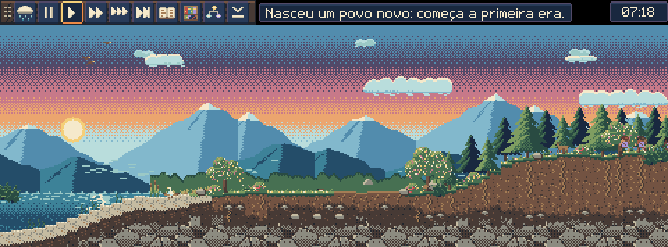

## 2. O gesto do poder

1. Na alça, clique no botão dos poderes e escolha um dos 11.
2. Clique sobre o mundo e **segure**. Uma barra mostra a carga: quanto mais tempo segurar, mais forte.
   - **Gesto curto: um sinal.** Algo pequeno, que pode passar por acaso.
   - **Segurando mais de 1 segundo: um milagre.** Algo inegável. A carga cheia leva 2 segundos.
   - **O fogo curto é o fogo brando:** acende as fogueiras e aquece o povo, sem queimar. Serve para a prece de frio.
3. Solte. A alça conta o que aconteceu.

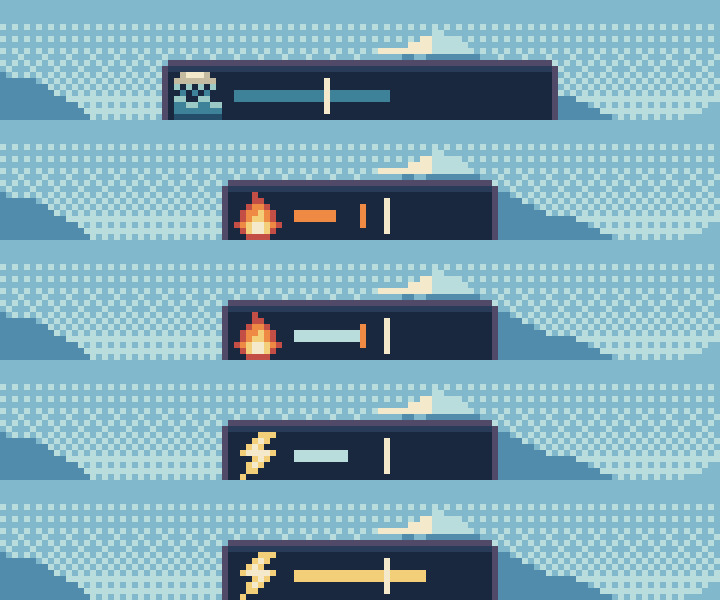

*A barra de carga, de cima para baixo: o dilúvio quase cheio, o fogo brando (curto), o fogo um pouco mais forte, o raio como sinal e o raio como milagre (além da marca do meio).*

O raio, o sonho e a cura acertam a pessoa que está sob o cursor. Usar o mesmo poder pela 3ª vez no mesmo lugar em até 3 dias vira uma **imposição**: o povo entende que só um deus faria aquilo.

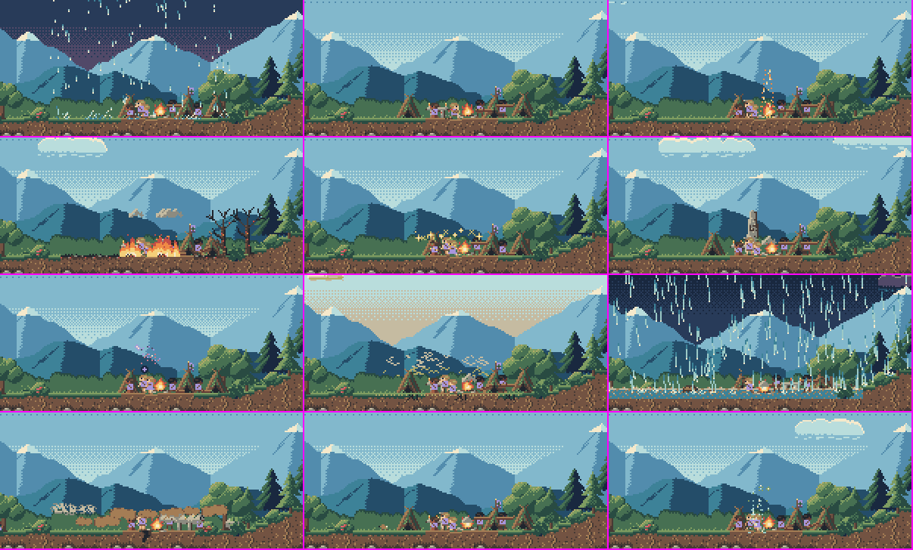

*Os poderes de dia: a chuva escurece o céu, o fogo brando desce sem queimar, o fogo forte queima e deixa as árvores mortas, a fartura brilha, a terra se ergue, a seca amarela o céu, o dilúvio alaga e o terremoto levanta poeira.*

Os detalhes de cada poder estão em [Mecânicas](mecanicas.md#os-11-poderes).

## 3. Quem são essas pessoas

Passe o cursor sobre alguém para ver o nome, a idade, o humor, o que está fazendo e, em lilás, o que está pensando. O pensamento sai do que a pessoa viveu de verdade: a fome, uma prece, um filho, o que ela acha do deus.

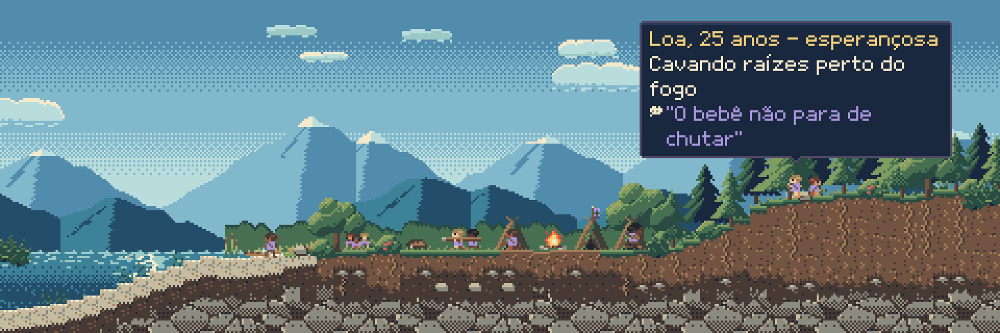

**A família que você acompanha.** O jogo segue uma família. A tecla **L** leva a vista até ela. Quando a pessoa acompanhada morre, o acompanhamento passa ao descendente vivo mais velho.

## 4. As preces

Quando alguém pede algo ao deus, aparece um sinal de luz sobre o povo. Passe o cursor sobre ele para ler a prece, há quantos dias ela espera e qual poder a atende.

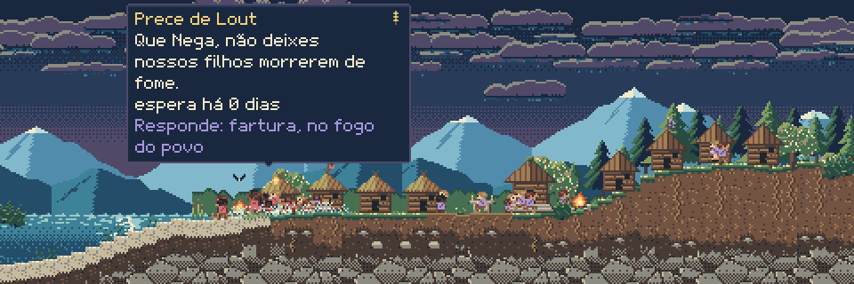

O povo pede chuva na seca, comida na fome, cura na doença, calor no frio e proteção na guerra. Você pode atender, ignorar ou fazer o contrário, e cada escolha tem consequência. Um povo que deixou de crer não reza, e os problemas dele chegam tarde até você.

**A caixa de preces.** O botão no fim da alça, depois da lupa, ou a tecla **P**, abre a caixa com as preces do povo, das mais novas para as mais antigas. Cada prece mostra:
- quem pediu, de que povo e quando;
- o pedido, nas palavras da pessoa;
- o estado: **esperando**, **atendida**, **atendida, mas não por você** (a necessidade passou sozinha, e o povo achou que foi você) ou **sem resposta**.

Clique numa prece para a vista ir até quem rezou. A roda do mouse rola a lista; Esc, o botão direito ou um clique fora fecham a caixa. Um ponto no botão avisa que chegou prece nova desde a última vez que você abriu a caixa. Quem não reza não aparece ali.

**O termômetro de fé.** No topo da caixa, cada povo tem um termômetro, sem número: a cor diz quanto o povo crê, e a seta diz se a fé está esquentando ou esfriando. A fé continua sendo de cada pessoa; o termômetro mostra a média do povo. O mesmo termômetro aparece quando você passa o cursor sobre a vila.

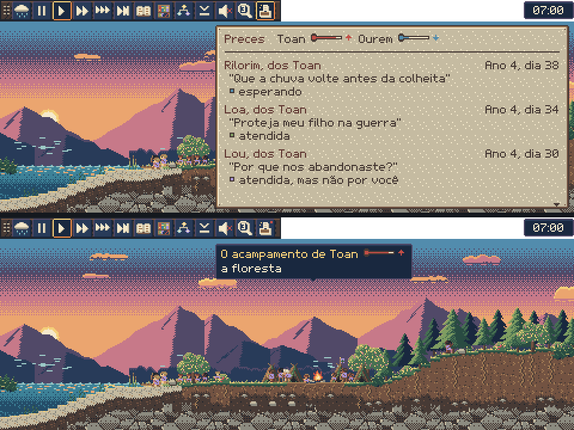

*Em cima, a caixa de preces aberta; embaixo, o termômetro na dica da vila. A tela foi montada com preces de exemplo, para mostrar os estados.*

## 5. A crônica

A tecla **C** abre a crônica do mundo: o resumo de até agora, os capítulos de cada estágio e os anos, um parágrafo por ano. As setas ↑ e ↓ trocam de capítulo. Os gestos do deus no ano em curso aparecem no fim.

**A vida do povo também entra.** Além dos atos do deus, cada ano tem uma linha para quem nasceu, casou e morreu. Num povo pequeno, a crônica dá os nomes e, nas mortes, a idade e a causa. Num povo grande, ela dá a conta do ano e nomeia só os casos notáveis, como gêmeos ou a morte do líder. Essa parte ainda está sendo ajustada, então o jeito de contar pode mudar entre as versões.

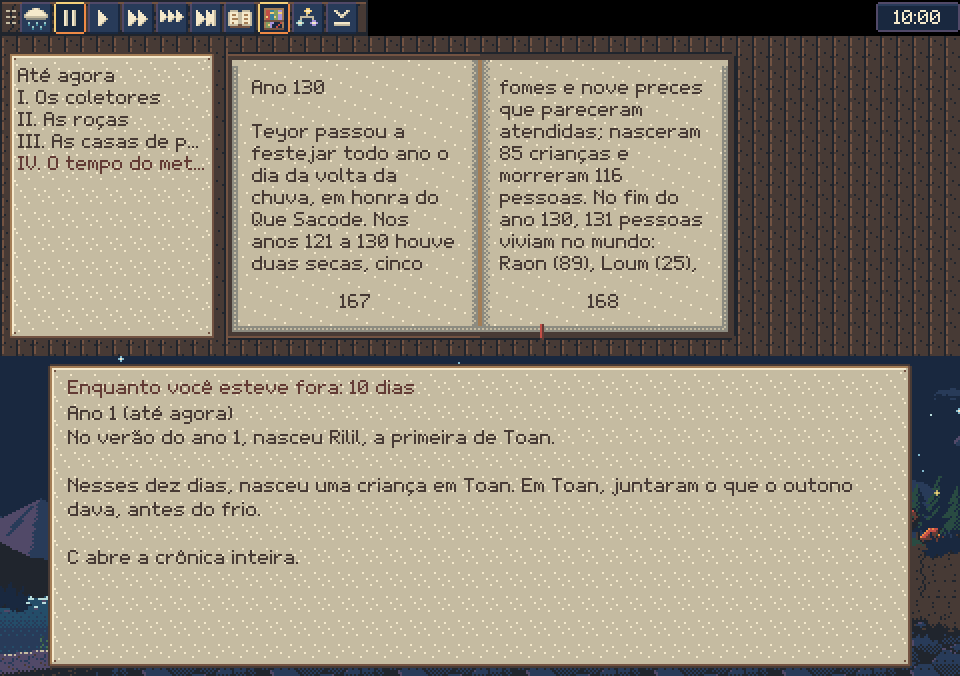

**Quando você volta.** O mundo segue vivendo com o jogo fechado, até 1 ano de jogo. Ao abrir de novo, um resumo conta o que aconteceu enquanto você esteve fora.

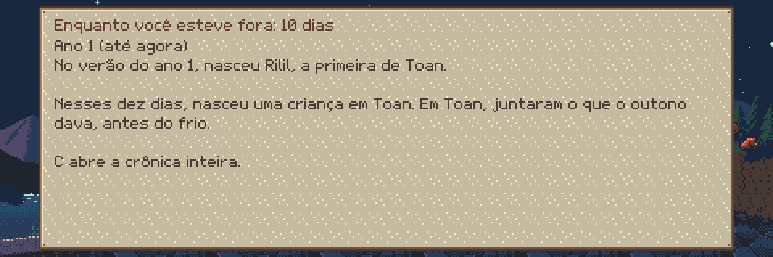

## 6. A estante

A tecla **E** abre a estante. Cada mundo que acaba, por extinção ou porque você o abandonou, vira um livro: título, "Em resumo", um capítulo por estágio, "Quem foi quem" e o epitáfio.

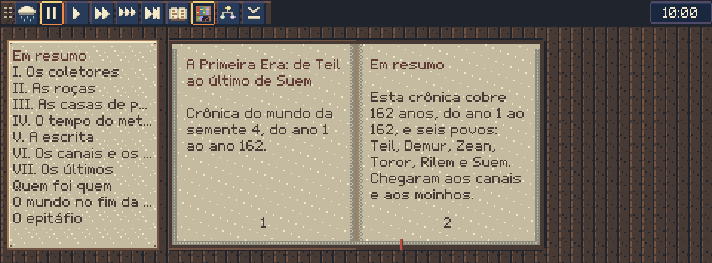

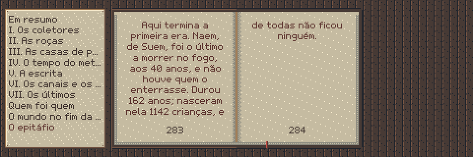

**Começar de novo.** Do segundo ano em diante, a estante mostra o botão "Abandonar este mundo". A crônica vira livro, e começa outro mundo. Se o povo acabar sozinho, o mundo fica vazio, as ruínas ficam, e você pode fazer nascer outro povo quando quiser, clicando sobre o mundo.

## 7. Velocidade

| Tecla | Ritmo | Um dia de jogo dura |
|---|---|---|
| **0** | pausa | — |
| **1** | normal | cerca de 45 min |
| **2** | 10x | 4,5 min |
| **3** | 50x | 54 s |
| **S** | salta até o próximo acontecimento | — |

A barra de espaço pausa e continua. O ritmo normal é o pensado para deixar aberto o dia todo; as velocidades maiores são para quando você está olhando. Veja [Tempo e evolução](tempo-e-evolucao.md).

## 8. Esconder e trazer de volta

- **H** (ou o último botão da alça) esconde a janela na hora.
- Para trazer de volta, clique no ícone do jogo perto do relógio do Windows. No Windows 11, ele pode estar escondido na setinha "^". O atalho **Ctrl+Alt+H** também traz de volta.
- **D** liga o **modo discreto**: as cenas mais pesadas (o raio que mata, o fogo sobre as pessoas, a luta) não são mostradas em detalhe, mas ficam registradas na crônica.

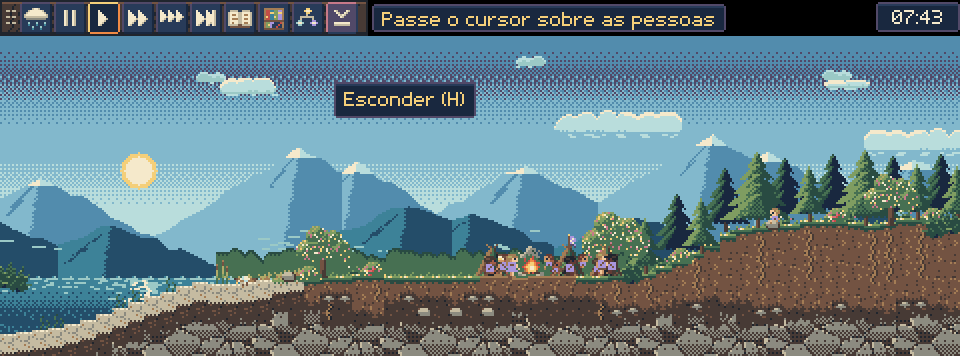

**O tamanho da janela:** o botão da lupa na alça (clique aumenta, botão direito diminui), Ctrl+2, Ctrl+3 e Ctrl+4, ou a roda do mouse sobre a alça. A escala é sempre inteira, para os pixels não distorcerem. O jogo guarda o tamanho e a posição.

## 9. Todas as teclas

| Tecla | O que faz |
|---|---|
| C | crônica do mundo (↑ e ↓ trocam de capítulo) |
| E | estante |
| P | caixa de preces |
| L | seguir a família acompanhada |
| D | modo discreto |
| H ou F8 | esconder a janela |
| Ctrl+Alt+H | esconder e trazer de volta, de qualquer lugar |
| 0, 1, 2, 3 | pausa, 1x, 10x, 50x |
| Espaço | pausa e continua |
| S | saltar até o próximo acontecimento |
| Esc | fecha a crônica, a estante ou a caixa de preces |
| M | liga e desliga o som |
| Ctrl+2, Ctrl+3, Ctrl+4 | tamanho da janela (ou a lupa na alça) |
| Ctrl+Q | sair (o mundo é salvo) |

## 10. Onde fica o mundo salvo

O mundo é salvo sozinho, a cada dia de jogo e ao fechar. A pasta é:

```
%APPDATA%\Simulador de vida
```

Cole esse caminho na barra de endereço do Explorador de Arquivos.

| Arquivo | O que é |
|---|---|
| `mundo.txt` | o mundo de agora (`mundo.1.txt`, `mundo.2.txt`... são as cópias de segurança) |
| `estante\` | os livros dos mundos que você deixou |
| `logs\godot.log` | o registro, para mandar se der erro |

Para apagar tudo e começar do zero, feche o jogo e apague essa pasta.

## 11. Desinstalar

Apague o arquivo `Simulador de vida.exe` e a pasta `%APPDATA%\Simulador de vida`. Não há instalador nem outros arquivos.

## 12. Se der erro

Veja [Relatar um erro](../README.md#relatar-um-erro). Mande a versão (passe o cursor sobre o relógio, no canto da alça), o que você fez logo antes e o arquivo `godot.log`.
