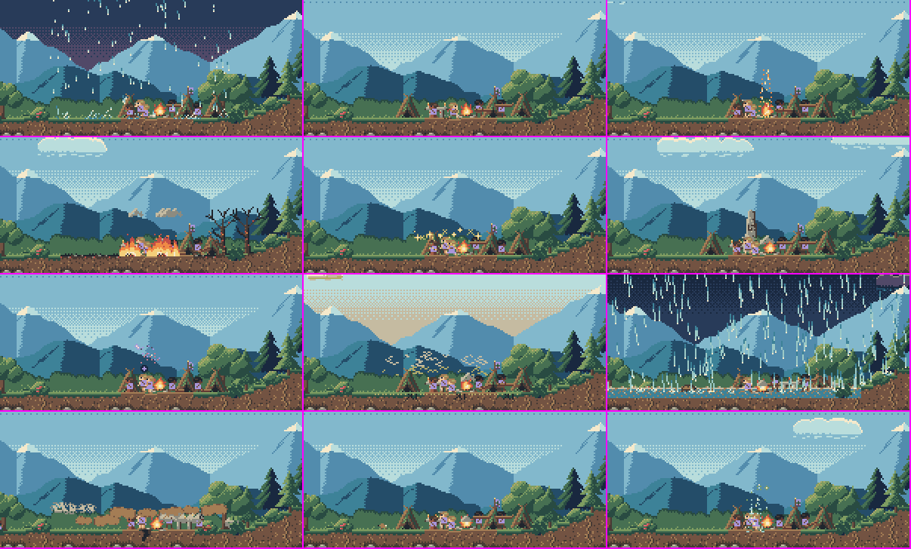
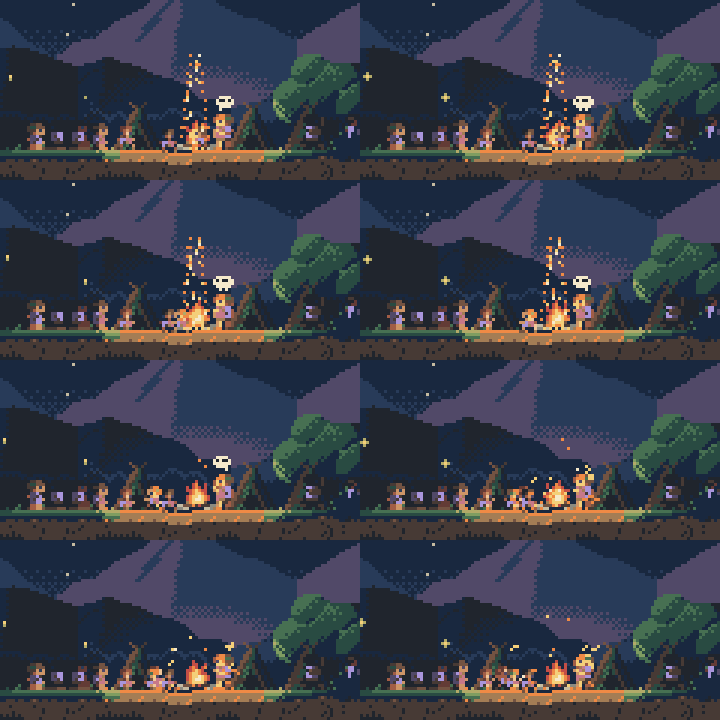
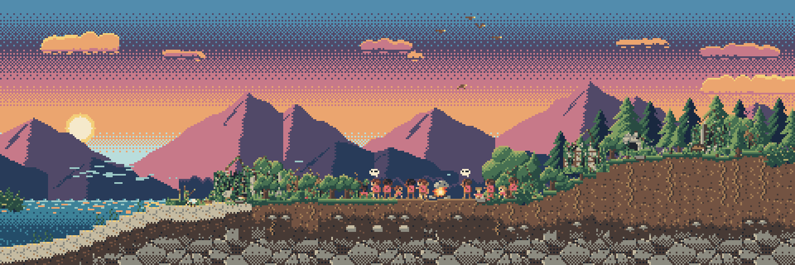
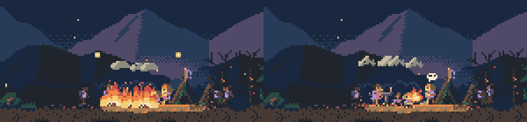

# Mecânicas

*Simulador de vida 0.1.1. [Voltar ao início](../README.md)*

Para quem quer saber o que acontece por baixo. Nada aqui é preciso para jogar: o jogo foi feito para ser descoberto olhando. Os detalhes vêm do núcleo da simulação (`jogo/nucleo/`, documentado em `jogo/nucleo/API.md`).

**A regra de tudo:** o deus é invisível. O povo só vê os efeitos e os interpreta pelo que já viveu. O custo de intervir não é mana nem recurso: é a interpretação.

## Os 11 poderes

Todos os poderes estão disponíveis desde o início. Não há desbloqueio nem custo.

### As intensidades

O gesto carrega enquanto você segura o botão sobre o mundo. A carga vai de 0 a 1 e enche em 2 segundos.

| Grau | Como sai | O que o povo entende |
|---|---|---|
| **Sinal** | carga abaixo de 0,5 (menos de 1 segundo segurando) | algo que pode ser acaso; a reação é fraca e dividida |
| **Milagre** | carga de 0,5 para cima | algo inegável; a reação é forte |
| **Imposição** | o 3º uso do mesmo poder no mesmo lugar em até 3 dias | só um deus faria aquilo; força tréguas e certezas |
| **Fogo brando** | o fogo com carga abaixo de 0,35 (o gesto curto) | o deus mandou o calor: as fogueiras acendem e ninguém sente frio por 6 dias, sem queimar nada |

Na chuva, na fartura, na seca, no fogo, no dilúvio e no terremoto, a carga também regula a força dentro do grau. O raio, o sonho e a cura acertam quem está sob o cursor.

### O que cada um faz

| Poder | Sinal | Milagre | Imposição |
|---|---|---|---|
| **Chuva** | garoa: sobe a água, a seca não acaba | acaba a seca naquela zona; os vizinhos ainda secos sentem inveja | idem, e força a trégua entre o povo da zona e os inimigos |
| **Raio** | cai perto e não mata ninguém | mata quem está sob o cursor, e o povo lê como castigo, martírio ou azar | idem, mais a trégua forçada; o lugar fica amaldiçoado |
| **Fartura** | comida a mais, que parece natural | acaba a fome; os povos famintos de outras zonas sentem inveja | como o milagre |
| **Fogo** | brando (acima) ou, um pouco mais forte, queima pouco | queima a zona, as cabanas e o estoque, e pode matar; lido como purificação ou maldição | como o milagre |
| **Erguer a terra** | uma pedra estranha | uma pedra alta: o lugar fica sagrado, ganha nome e impõe trégua | como o milagre |
| **Sonho** | um sonho vago, que muitos ignoram | a ideia do próximo saber (como plantar), ou uma visão que pode fazer um sacerdote | o sonho é aceito com certeza, e há paz com os inimigos |
| **Seca** | a zona seca um pouco | a zona seca de 6 a 28 dias, conforme a carga; o povo pergunta "o que fizemos?" | seca dobrada, e oferendas |
| **Dilúvio** | a água sobe e cobre a zona | com carga de 0,7 para cima, a água chega às zonas vizinhas, e vidas se perdem; vira mito, e o lugar ganha nome | o mundo inteiro alaga |
| **Terremoto** | um tremor fraco | a zona treme forte: cabanas caem, pode matar, e é lido como castigo | como o milagre |
| **Presságio** | um sinal no céu, visto por todos os povos | mais forte; a forma (cometa, eclipse ou luzes) vem da carga | como o milagre |
| **Cura** | em alguém são, só bem-estar | quem está doente se levanta; nasce um devoto, às vezes um sacerdote | cura todos os doentes do povo |

**Cada povo lê do seu jeito.** Um presságio é bom agouro para quem é devoto, mau agouro para os rancorosos e os que sofreram, e aviso para os desconfiados, que passam a estocar.

**O gesto repetido vira hábito.** O mesmo gesto bom sobre o mesmo povo, pela 4ª vez num ano, vira costume: a chuva vira a festa da chuva; a fartura e a cura viram oferendas. Pela 6ª vez, a chuva, a fartura e a cura viram **dependência**: o povo para de guardar comida, passa a pedir coisas pequenas e, no primeiro silêncio, paga caro. Os gestos que ferem criam o medo: oferendas e, às vezes, um nome novo para o deus.

## Preces e respostas

Um povo que crê reza quando precisa. A prece aparece como um sinal de luz sobre o povo e espera. Todas as preces ficam também na caixa de preces (tecla **P**), com o estado de cada uma e um termômetro de fé por povo, sem número, com a tendência ([como jogar](como-jogar.md#4-as-preces)).

| O povo pede | Atende | Contraria (quando cai sobre quem reza) |
|---|---|---|
| chuva, na seca | chuva | seca, fogo, dilúvio, terremoto |
| comida, na fome | fartura | seca, fogo, dilúvio, terremoto |
| cura, na doença | cura, no doente | o raio que mata alguém do povo, fogo, dilúvio, terremoto |
| calor, no frio | o fogo brando | o fogo forte, o raio que mata, dilúvio, terremoto |
| proteção, na guerra | raio ou terremoto **no povo inimigo** | os mesmos, no próprio povo |
| coisas pequenas ("que amanhã faça sol para a pesca") | nada: são de um povo que se acostumou a ser atendido, e somem sozinhas | |

**O que acontece depois:**
- **Atendida pelo deus:** a fé sobe, e o povo agradece.
- **Atendida pelo acaso:** a necessidade passou sozinha. O povo agradece do mesmo jeito: é o **falso milagre**. O acaso convence menos que o deus (a fé sobe cerca de metade).
- **Sem resposta em 14 dias:** a fé cai. Depois de três silêncios, o povo procura uma explicação (abaixo).
- **Contrariada:** o deus fez o contrário do que se pedia. A fé de quem rezou despenca, e essa pessoa se sente ferida pelo deus.
- Quem rezou pensa no desfecho por dois dias, e isso aparece na dica da pessoa: "O Que Nega ouviu a nossa prece", "Pedi chuva, e veio o castigo".

**O ponto cego.** Um povo sem crença, ou cético, não reza, e os problemas dele não chegam como prece. Você continua vendo o mundo, mas sabe menos do que ele quer.

## Religião, nomes do deus e sacerdotes

**Como a crença nasce.** No começo, o povo não tem religião. Cada coisa inexplicável que ele vê, seja um gesto do deus, seja um eclipse, um cometa, um terremoto natural ou o nascimento de gêmeos, soma mistério. Quando o mistério passa de um limite, o povo dá um nome ao deus, tirado do que viu: a chuva dá "o Que Rega" ou "a Mãe da Chuva"; o raio, "o Que Fere" ou "o Senhor do Trovão"; o terremoto, "o Que Sacode"; o eclipse, "o Olho Escuro". A crônica guarda quem deu o nome: a pessoa de mais fé do povo.

**Cada povo tem o seu nome.** Dois povos vivos nunca chamam o deus do mesmo jeito, a não ser que um tenha nascido do outro e levado a fé junto. Pelo menos 12 anos depois do último nome, um acontecimento forte de outra natureza pode rebatizar o deus.

**Quando o deus se cala.** Depois de três preces sem resposta, o povo explica o silêncio. A explicação que vence depende dos traços de quem está vivo:

| Explicação | Quem puxa |
|---|---|
| "Nós pecamos." | os devotos e os medrosos |
| "Ele está nos testando." | os devotos e os corajosos |
| "Ele está dormindo ou partiu." | ninguém em especial: é a que sobra quando nenhum traço puxa outra |
| "Ele favorece os outros." | os rancorosos e os ambiciosos, quando outro povo foi atendido há pouco |
| "Os sacerdotes mentem." | os desconfiados, quando há sacerdote |
| "Ele não existe." | os desconfiados e os de pouca fé |

**Sacerdotes.** Um adulto de muita fé pode passar a falar pelo deus. O sacerdote reza no altar de manhã e ao entardecer e pode baixar **éditos**: em nome do deus, proíbe o povo de tratar com um povo rival. O deus nunca disse aquilo, e uma guerra pode começar assim. Do estágio 3 em diante, os sacerdotes ficam mais fortes, e o poder pode passar ao templo.

**Profetas e cismas.** Alguém pode pregar outro nome para o deus. Se o povo aceita, o deus muda de nome. Se o templo chama de heresia, os seguidores vão embora e fundam outro povo.

**A fé morre e volta.** Depois de 15 anos sem nenhum gesto do deus, a fé de quem não é devoto esfria a cada ano. Um povo esquecido pelo deus pode se secularizar a partir do estágio 3, e um povo que chega à escrita pode deixar de rezar: os sábios explicam a chuva e o raio. Mesmo assim, um gesto inegável pode trazer a fé de volta, num **renascimento**.

## Culturas

**Cultura é memória que virou hábito.** Os costumes nascem do que o povo viveu: depois de uma grande seca, o povo passa a poupar água; o dia da chuva milagrosa vira festa; depois de um raio, ninguém sobe o morro em dia de tempestade.

Cada povo tem 6 dimensões culturais, que não aparecem como números, só no comportamento:

| Dimensão | Polos |
|---|---|
| Relação com o deus | devota, temerosa, cética |
| Relação com estranhos | acolhedora, desconfiada |
| Poder | um líder, um conselho, os sacerdotes |
| Recursos | partilha, acumula |
| Violência | pacífica, guerreira |
| Os mortos | enterram, queimam, veneram |

- **Os costumes que aparecem:** estocar, poupar água, a festa da chuva, o tabu da tempestade, queimar os mortos, as lanças, as oferendas.
- **Como os povos se separam:** por migração (famílias fundam outra vila), por briga ou por cisma religioso. O povo novo herda a aparência do antigo e muda duas coisas: a cor da roupa, o telhado, a parede ou o símbolo.
- **Como as culturas mudam:** por revolta contra o templo, por golpe, por cansaço de um líder só, pelos casamentos entre povos e por reforma, quando uma geração abandona um costume cuja origem ninguém lembra mais. Com a escrita, os costumes não se esquecem mais.
- **Os lugares ganham nome** pelo que aconteceu neles, e cada povo dá o seu: "Lago da Vitória de Peak".
- **O deus não edita culturas.** Ele só as influencia pelos efeitos que causa.

**Conflito.** As guerras começam por fome, por terra (dois povos na mesma zona), por um édito, por rancor ou entre povos irmãos. Uma briga vira guerra com nome na segunda batalha e termina em trégua, imposição do deus, conquista, extinção, ou simplesmente esfria.

## Linhagem

O jogo acompanha uma família. A tecla **L** leva a vista até a pessoa acompanhada. Quando ela morre, ou parte além da borda do mundo, o acompanhamento passa ao descendente vivo mais velho: filhos, depois netos, e assim por diante. A crônica registra a passagem.

## Fim do mundo, ruínas e estante

- **A extinção é real.** O povo pode acabar por fome, peste, guerra ou pelos gestos do deus, inclusive enquanto o jogo está fechado. Quando restam 5 pessoas ou menos, aparece o chamado mais forte do jogo: "os últimos".
- **O mundo vazio continua vivo.** O clima segue, o mato cobre as casas, o templo vira ruína, e os túmulos ficam.
- **Criar um povo novo** é o único poder que só existe com o mundo vazio: o deus nunca cria pessoas num mundo habitado. Uma família de 12 coletores chega, com uma cultura nova, e começa uma nova era.
- **O povo novo encontra as ruínas** e cria explicações para elas ("gigantes", "um castigo do deus", ou "gente como nós"). Alguém pode reaprender ali um saber perdido. O nome do povo antigo aparece entortado pelo tempo.
- **A crônica se fecha como livro** quando o mundo acaba ou quando você o abandona. O livro tem título com epíteto ("A Primeira Era: de Teil ao último de Suem"), "Em resumo", um capítulo por estágio, "Quem foi quem", o mundo no fim e o epitáfio. Os livros ficam na estante (tecla **E**), guardados com cópia de segurança.
- **Os povos pequenos não morrem em silêncio.** Num povo com menos de 20 pessoas em que ninguém mais pode casar, às vezes chegam 2 ou 3 jovens de além da borda do mundo e ficam.
- **A borda do mundo é o fim do mundo.** Às vezes uma família parte em expedição além da borda e nunca volta.

## Modo discreto

O mundo nunca é suavizado: o pior pode acontecer, e a crônica sempre conta. O modo discreto (tecla **D**) só muda o que a tela mostra, para quando há outras pessoas olhando.

| Cena | Normal | Discreto |
|---|---|---|
| Raio que mata | o raio e o impacto | só o clarão |
| Fogo (milagre) | chamas sobre as pessoas | brasas e fumaça; as árvores queimadas ficam |
| Terremoto | a fenda, a poeira, as pedras e o tremor | sem a fenda; a poeira, as pedras e as casas no chão ficam |
| Guerra | as duas linhas lutando | as linhas frente a frente, paradas |
| Caçada | a lança voando e o porco atingido | o porco já caído, sem o golpe |

O modo fica guardado entre uma sessão e outra. **H** esconde a janela inteira na hora.

## O estilo do deus muda o povo

A sessão de simulação jogou 3 mundos por 100 anos com quatro estilos de deus (`jogo/ferramentas_sim/estilos/`). Médias no fim:

| | Benevolente | Cruel | Ausente | Caprichoso |
|---|---|---|---|---|
| População | 457 | 85 | 63 | 111 |
| Fé média (de −1 a 1) | 0,63 | −0,99 | 0,10 | 0,28 |
| Nomes que o deus teve | 10,3 | 7,3 | 3,7 | 8,0 |
| Povos que ficaram dependentes | 4,0 | 0 | 0 | 0 |
| Mortos pelo deus | 0 | 44,3 | 0 | 2,7 |

Nenhum extremo é o "certo": a escolha é sobre que tipo de povo você quer ver.
